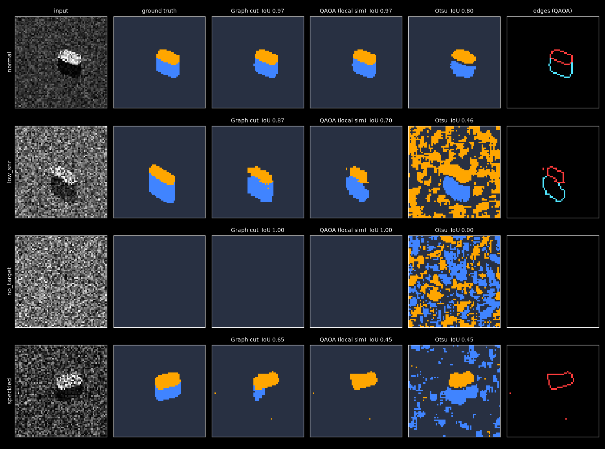
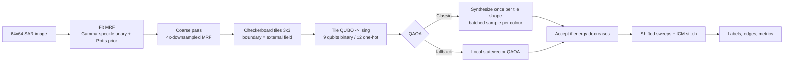

# QuantumSAR

**Segmenting Synthetic Aperture Radar images with quantum optimisation.**
Each pixel's label is a spin; the Markov-random-field energy of the Thales SAR use case becomes an Ising
Hamiltonian that is solved tile-by-tile with **QAOA on Classiq**, and benchmarked against Otsu, k-means,
ICM, simulated annealing and exact graph cut.



* 2-class (target / background) and 3-class (target / shadow / background) segmentation
* edge detection (2-pixel definition, single-pixel variant, target vs shadow edges)
* FastAPI backend + React web UI built with [React Bits](https://reactbits.dev) animated components
  (Aurora, SplitText, SpotlightCard, CountUp, StarBorder, …), Docker, CI, Hugging Face Spaces / Render deployment
* every result states where it came from: live Classiq, cached Classiq run, or local fallback

## Contents

| path | |
|---|---|
| `src/quantumsar/` | model (`mrf.py`), QUBO/Ising (`qubo.py`), tiling (`tiling.py`), solvers (`solvers/`), Classiq auth helper (`auth.py`), pipeline |
| `api/main.py` | REST API: `/segment`, `/edges`, `/benchmark`, `/health`, `/samples`, `/solvers` |
| `frontend/` | React + TypeScript + Tailwind web UI (React Bits components in `src/components/reactbits/`), served by FastAPI at `/` |
| `app/streamlit_app.py` | classic Streamlit UI (optional) |
| `tests/` | 40+ tests incl. QUBO ≡ MRF, brute-force agreement on 3×3 / 4×4 tiles |
| `notebooks/QuantumSAR_walkthrough.ipynb` | explanatory notebook (executed) |
| `data/synthetic/` | 50 MSTAR-like samples + `scripts/generate_dataset.py`; put MSTAR chips in `data/mstar/` |
| `results/` | benchmark tables, figures, precomputed Classiq runs (`quantum_cache/`) |
| `docs/` | architecture & method, Classiq auth, deployment, use-case checklist |
| `video/` | reproducible demo video pipeline (`make_video.sh`) |

## Method in one screen



* **Energy**: `E(x) = Σᵢ θᵢ(xᵢ) + λ Σ₍ᵢⱼ₎ [xᵢ ≠ xⱼ]`, θᵢ(k) = L (zᵢ/μₖ + log μₖ) (Gamma negative log-likelihood,
  L = number of looks estimated from the image).
* **QUBO**: `[xᵢ≠xⱼ] = xᵢ + xⱼ − 2xᵢxⱼ`; 3 classes use one-hot bits with penalty `P(Σₖ yᵢₖ − 1)²`.
* **QAOA**: cost layer `RZ(2γhᵢ)` and `CX·RZ(2γJᵢⱼ)·CX`, mixer `RX(2β)`. All coefficients are execution
  parameters, so one synthesized Classiq program serves every tile of a shape and a whole checkerboard
  colour runs as one batched job. Angles are pre-trained on a local statevector and transferred.

Details: [docs/architecture.md](docs/architecture.md).

## Results

<!-- RESULTS:START -->
<!-- RESULTS:END -->

## Setup

Python 3.11.

### Linux / macOS

```bash
python3.11 -m venv .venv && source .venv/bin/activate
pip install -r requirements-dev.txt
python -m pytest -q                                   # tests
(cd frontend && npm ci && npm run build)              # React UI -> frontend/dist (Node 20+)
uvicorn api.main:app --port 8000                      # UI http://localhost:8000 · API docs /docs
# UI development with hot reload: (cd frontend && npm run dev) -> http://localhost:5173
```

### Windows (PowerShell)

```powershell
py -3.11 -m venv .venv; .\.venv\Scripts\Activate.ps1
pip install -r requirements-dev.txt
python -m pytest -q
cd frontend; npm ci; npm run build; cd ..
uvicorn api.main:app --port 8000          # open http://localhost:8000
```

### Docker (one command)

```bash
docker compose up --build      # http://localhost:7860 (UI) · http://localhost:7860/docs (API)
# or: docker build -t quantumsar . && docker run -p 7860:7860 quantumsar
# classic Streamlit UI as well: docker compose --profile streamlit up --build  (port 8501)
```

### Classiq (optional, for live quantum runs)

```bash
python -c "from quantumsar.auth import setup_classiq_auth; setup_classiq_auth(); import classiq; classiq.authenticate()"
QUANTUMSAR_ALLOW_LIVE_CLASSIQ=1 uvicorn api.main:app --port 8000
python scripts/precompute_quantum.py --classes 2     # refresh the cached Classiq results
```

On Windows, `setup_classiq_auth()` applies the `keyrings.alt` workaround for the
`(1783, 'CredWrite', 'The stub received bad data.')` error. See [docs/classiq_auth.md](docs/classiq_auth.md).
Never commit `config.env` (it is git-ignored; start from `.env.example`).

### Reproduce everything

```bash
python scripts/generate_dataset.py --n 50          # data/synthetic
python scripts/precompute_quantum.py --classes 2   # Classiq runs (needs auth, ~2.5 min/image)
python scripts/run_benchmark.py                    # results/*.csv, figures, RESULTS.md
python scripts/build_notebook.py                   # executes the notebook
./video/make_video.sh                              # demo video
```

## Deployment

* **Hugging Face Spaces** (Docker SDK, free): `HF_SPACE=<user>/quantumsar ./deploy/huggingface/push_space.sh`
  (uses `deploy/huggingface/README.md` as the Space card, port 7860).
* **Render** (free web service): connect the repo; `render.yaml` is a ready blueprint.
* **CI**: `.github/workflows/ci.yml` runs the test suite and a Docker build + `/health` smoke test.

Live Classiq execution needs credentials that free hosts can't obtain interactively, so the deployed app
serves precomputed Classiq results and falls back to the local QAOA simulator otherwise (clearly labelled).
See [docs/deployment.md](docs/deployment.md).

## Honest limitations

* **Not a quantum speed-up.** For the binary problem the MRF energy is submodular and graph cut finds the
  *exact* optimum in milliseconds. QAOA reaches the same or nearly the same energy, but on simulators it
  is orders of magnitude slower. The value here is a correct, verified, end-to-end quantum formulation that
  scales with hardware.
* **Qubit limits force tiling.** 4096 pixels → tiles of 9 qubits (binary) or 12 qubits (3-class one-hot).
  The quantum solver optimises local blocks with fixed borders; global optimality is not guaranteed.
  A coarse pass, shifted grids and ICM stitching close most of the gap (see energy gap column).
* **3-class is harder.** One-hot encoding triples the qubits and the penalty terms flatten the landscape
  (lower probability of sampling the optimum); α-expansion remains better there.
* **QAOA angles** are optimised on a classical statevector (cheap at ≤ 20 qubits) and transferred between
  tiles; optional on-Classiq optimisation (`optimise_on_classiq=True`) is much slower.
* **Live Classiq runs** take ~2–4 min per image (cloud round-trips, one batched job per checkerboard colour
  and sweep). The public demo therefore uses cached Classiq results.
* **Data** are synthetic (Gamma speckle, MSTAR-like geometry). Real MSTAR chips can be dropped into
  `data/mstar/` (`.png` or `.npz` with `image[, labels]`), but no real-data results are reported here.
