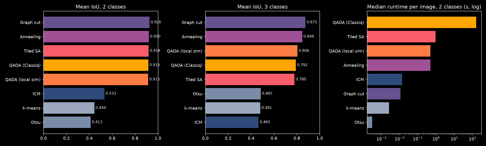
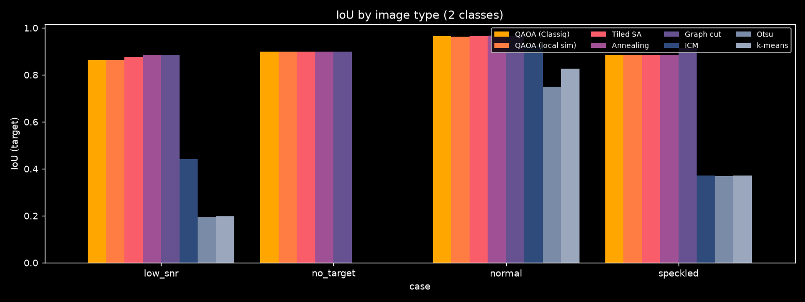

# QuantumSAR benchmark results

Synthetic MSTAR-like dataset, 50 images of 64x64. Classiq rows only cover the images whose Classiq run is cached (`results/quantum_cache/`); runtime for Classiq is the wall time of the live cloud run.

## 2 classes

|                  |   accuracy |   iou |   dice |   median runtime (s) |   energy |   images |   energy gap to optimum (%) |   edge F1 |
|:-----------------|-----------:|------:|-------:|---------------------:|---------:|---------:|----------------------------:|----------:|
| Graph cut        |      0.998 | 0.926 |  0.952 |                0.011 |  712.615 |   50.000 |                       0.000 |     0.824 |
| Annealing        |      0.998 | 0.920 |  0.948 |                0.480 |  712.993 |   50.000 |                       0.035 |     0.818 |
| Tiled SA         |      0.998 | 0.918 |  0.947 |                0.912 |  713.760 |   50.000 |                       0.127 |     0.804 |
| QAOA (Classiq)   |      0.998 | 0.916 |  0.946 |              159.009 |  713.894 |   50.000 |                       0.143 |     0.803 |
| QAOA (local sim) |      0.998 | 0.915 |  0.945 |                0.485 |  713.913 |   50.000 |                       0.147 |     0.801 |
| ICM              |      0.962 | 0.533 |  0.607 |                0.014 |  948.178 |   50.000 |                      27.319 |     0.431 |
| k-means          |      0.706 | 0.444 |  0.498 |                0.003 | 2114.223 |   50.000 |                     187.073 |     0.226 |
| Otsu             |      0.664 | 0.413 |  0.464 |                0.000 | 2331.611 |   50.000 |                     230.077 |     0.212 |

## 3 classes

|                  |   accuracy |   iou |   dice |   median runtime (s) |   energy |   images |
|:-----------------|-----------:|------:|-------:|---------------------:|---------:|---------:|
| Graph cut        |      0.991 | 0.875 |  0.899 |                0.045 | 1565.842 |   50.000 |
| Annealing        |      0.989 | 0.848 |  0.878 |                0.548 | 1569.083 |   50.000 |
| QAOA (local sim) |      0.986 | 0.806 |  0.843 |                1.443 | 1577.788 |   50.000 |
| QAOA (Classiq)   |      0.985 | 0.792 |  0.824 |              177.304 | 1540.589 |   10.000 |
| Tiled SA         |      0.983 | 0.780 |  0.828 |                2.941 | 1589.935 |   50.000 |
| Otsu             |      0.763 | 0.485 |  0.561 |                0.021 | 5066.985 |   50.000 |
| k-means          |      0.767 | 0.481 |  0.559 |                0.004 | 5148.960 |   50.000 |
| ICM              |      0.881 | 0.465 |  0.551 |                0.021 | 2197.124 |   50.000 |

## IoU by image type (2 classes)

| case      |   Annealing |   QAOA (Classiq) |   Graph cut |   ICM |   k-means |   Otsu |   QAOA (local sim) |   Tiled SA |
|:----------|------------:|-----------------:|------------:|------:|----------:|-------:|-------------------:|-----------:|
| low_snr   |       0.883 |            0.865 |       0.883 | 0.441 |     0.197 |  0.195 |              0.865 |      0.877 |
| no_target |       0.900 |            0.900 |       0.900 | 0.000 |     0.000 |  0.000 |              0.900 |      0.900 |
| normal    |       0.967 |            0.966 |       0.967 | 0.926 |     0.826 |  0.750 |              0.964 |      0.966 |
| speckled  |       0.884 |            0.883 |       0.915 | 0.371 |     0.371 |  0.369 |              0.883 |      0.883 |

## QAOA amplification

Mean probability of measuring the exact optimum of a tile, QAOA vs. uniform random guessing (12 uncertain tiles per size).

|   qubits |   p |   p_opt |   uniform |   amplification |
|---------:|----:|--------:|----------:|----------------:|
|        4 |   1 | 0.4941  | 0.0625    |           7.906 |
|        4 |   2 | 0.6142  | 0.0625    |           9.828 |
|        4 |   3 | 0.6379  | 0.0625    |          10.21  |
|        9 |   1 | 0.1903  | 0.001953  |          97.42  |
|        9 |   2 | 0.3172  | 0.001953  |         162.4   |
|        9 |   3 | 0.3218  | 0.001953  |         164.8   |
|       16 |   1 | 0.04815 | 1.526e-05 |        3155     |
|       16 |   2 | 0.1039  | 1.526e-05 |        6807     |
|       16 |   3 | 0.1114  | 1.526e-05 |        7302     |

