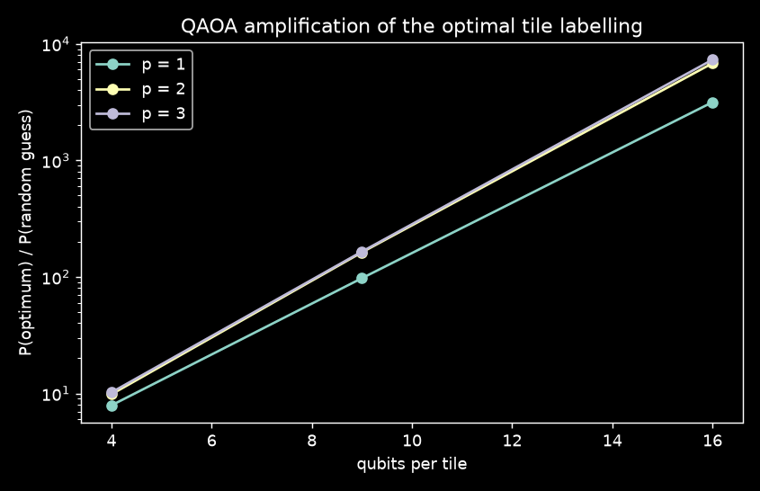
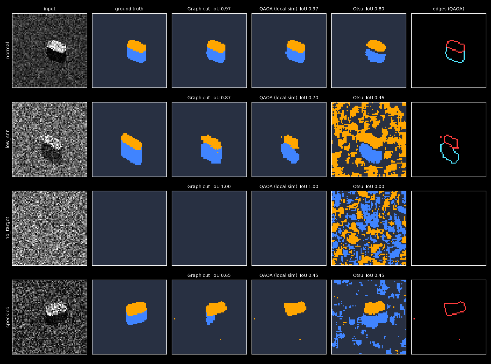

# QuantumSAR benchmark results

Synthetic MSTAR-like dataset, 10 images of 64x64. Classiq rows only cover the images whose Classiq run is cached (`results/quantum_cache/`); runtime for Classiq is the wall time of the live cloud run.

## 2 classes

|                  |   accuracy |   iou |   dice |   median runtime (s) |   energy |   images |   energy gap to optimum (%) |   edge F1 |
|:-----------------|-----------:|------:|-------:|---------------------:|---------:|---------:|----------------------------:|----------:|
| Annealing        |      0.998 | 0.947 |  0.972 |                0.482 |  668.340 |   10.000 |                       0.000 |     0.845 |
| Graph cut        |      0.998 | 0.946 |  0.971 |                0.011 |  668.337 |   10.000 |                       0.000 |     0.843 |
| Tiled SA         |      0.998 | 0.939 |  0.967 |                2.172 |  669.066 |   10.000 |                       0.087 |     0.825 |
| QAOA (local sim) |      0.998 | 0.935 |  0.965 |                0.480 |  669.163 |   10.000 |                       0.108 |     0.816 |
| QAOA (Classiq)   |      0.997 | 0.928 |  0.960 |              164.030 |  639.015 |    4.000 |                       0.000 |     0.804 |
| ICM              |      0.962 | 0.562 |  0.631 |                0.013 |  897.244 |   10.000 |                      26.087 |     0.453 |
| k-means          |      0.754 | 0.507 |  0.564 |                0.002 | 1881.179 |   10.000 |                     196.567 |     0.257 |
| Otsu             |      0.750 | 0.502 |  0.560 |                0.000 | 1890.075 |   10.000 |                     198.741 |     0.245 |

## IoU by image type (2 classes)

| case      |   Annealing |   QAOA (Classiq) |   Graph cut |   ICM |   k-means |   Otsu |   QAOA (local sim) |   Tiled SA |
|:----------|------------:|-----------------:|------------:|------:|----------:|-------:|-------------------:|-----------:|
| low_snr   |       0.866 |            0.767 |       0.866 | 0.585 |     0.409 |  0.401 |              0.849 |      0.849 |
| no_target |       1.000 |            1.000 |       1.000 | 0.000 |     0.000 |  0.000 |              1.000 |      1.000 |
| normal    |       0.971 |            0.973 |       0.971 | 0.943 |     0.836 |  0.832 |              0.961 |      0.971 |
| speckled  |       0.927 |          nan     |       0.921 | 0.336 |     0.454 |  0.447 |              0.906 |      0.906 |

## QAOA amplification

Mean probability of measuring the exact optimum of a tile, QAOA vs. uniform random guessing (12 uncertain tiles per size).

|   qubits |   p |   p_opt |   uniform |   amplification |
|---------:|----:|--------:|----------:|----------------:|
|        4 |   1 | 0.4941  | 0.0625    |           7.906 |
|        4 |   2 | 0.6142  | 0.0625    |           9.828 |
|        4 |   3 | 0.6379  | 0.0625    |          10.21  |
|        9 |   1 | 0.1903  | 0.001953  |          97.42  |
|        9 |   2 | 0.3172  | 0.001953  |         162.4   |
|        9 |   3 | 0.3218  | 0.001953  |         164.8   |
|       16 |   1 | 0.04815 | 1.526e-05 |        3155     |
|       16 |   2 | 0.1039  | 1.526e-05 |        6807     |
|       16 |   3 | 0.1114  | 1.526e-05 |        7302     |

